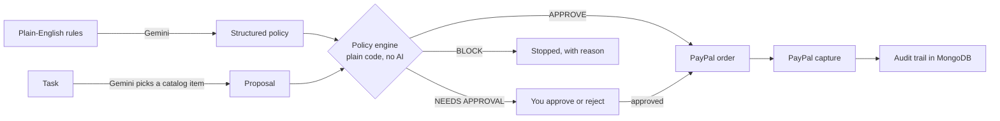

# PayGuard Agent

**Give your AI a wallet, not a blank cheque.**

PayGuard lets you set spending rules in plain English. An AI agent shops for you, but it can only spend what your rules allow. The AI *suggests*, plain code *decides*, and PayPal *executes*.

Built for the **PayPal AI Hackathon** (Build What's Next with PayPal and AI).

| | |
|---|---|
| **Live demo** | https://payguard-lake-seven.vercel.app/|
| **Demo video (under 3 min)** | https://youtu.be/IJyuyC5rzHg?si=k8InUjzUWzynyZsl |
| **Code** | You are here. MIT licensed. |

---

## The problem

AI agents can now search, compare and buy things for us. But nobody wants to hand an agent unlimited access to their money. Today the choice is all or nothing: trust the agent completely, or don't use it.

## What PayGuard does

1. **You write a spending mandate in plain English**, for example: *"Buy office supplies for my team. Max $50 per purchase, $200 per month, only stationery and office supplies. Ask me before anything above $30."*
2. **AI turns it into a structured policy** (limits, approval threshold, allowed categories).
3. **You give the agent a task**, for example: *"Get a whiteboard for the meeting room."*
4. **The agent picks an item** from a product catalog and proposes a purchase.
5. **A policy engine decides**, with a plain-language reason every time:
   - **APPROVE**: inside all limits, so a PayPal checkout is created.
   - **NEEDS APPROVAL**: above your threshold, so it waits for you to approve or reject.
   - **BLOCK**: outside your rules, so nothing is bought.
6. **PayPal executes** approved payments in the sandbox, and every step is saved in an **audit trail**.

### Why it is safe



- The AI only returns an **item ID** from the catalog. The **price and category come from the catalog, not from the AI**, so the AI cannot make an item look cheaper or fit a category.
- The approve / block decision is made by **deterministic code** (`backend/server/services/policy.js`), covered by unit tests.
- Even if the AI makes a mistake or is tricked by the task text, it **cannot overspend** your mandate.

---

## How PayPal is used

PayPal is the payment layer of the product. All calls use the **PayPal sandbox** (`api-m.sandbox.paypal.com`).

| PayPal feature | What it does in PayGuard |
|---|---|
| **OAuth 2.0 client credentials** | The backend gets an access token (cached until it expires). |
| **Orders v2: create order** | When the policy approves a purchase (or you approve it), a PayPal order is created for the exact total. |
| **PayPal checkout approval** | The buyer is redirected to PayPal's sandbox page to approve the payment. |
| **Orders v2: capture order** | After approval, PayPal returns to the app, which captures the payment and stores the capture ID. |

## How AI is used

**Model: Google Gemini** (`gemini-3.8-flash`, configurable through `GEMINI_MODEL`), called through the Gemini API with JSON output.

| Where | What the AI does | How it is kept safe |
|---|---|---|
| `services/mandate.js` | Converts the plain-English mandate into a JSON policy. | Output is validated with a **Zod** schema, with one automatic retry. Missing values are rejected, not invented. |
| `services/agent.js` | Reads the task and picks the best item **ID** from the catalog. | Only catalog IDs are accepted. Price and category are read from the catalog. |

The AI never moves money and never makes the final decision.

**Other tools:** MongoDB Atlas (data), Express (API), React + Vite (UI), Zod (validation).
**Sponsor tools used:** Render and vercel .

---

## Try it (for judges)

### Option 1: Hosted demo (about 2 minutes)

1. Open the live demo: TODO: add URL.
2. Click **Reset demo** first (it clears all data, including the policy), then click Create policy. A sample mandate is pre-filled.
3. Click **Create policy**. A sample mandate is pre-filled (limits: $50 per purchase, $200 per month, ask above $30).
4. Click each example task and check the result:

| Example task | Expected result |
|---|---|
| I need a pack of gel pens for the team | **APPROVE**: a PayPal checkout button appears |
| Get a whiteboard for the meeting room | **NEEDS APPROVAL**: click **Approve** and a PayPal checkout button appears |
| Buy an ergonomic office chair | **BLOCK**: above the $50 per-purchase limit |
| Buy wireless headphones | **BLOCK**: category "electronics" is not allowed |

5. To pay, click **Pay with PayPal (sandbox)** and log in with this **sandbox test buyer** (fake money, no real account needed):
   - Email: sb-fejm753759000@personal.example.com
   - Password: V+ci0+{>
6. After approving, you return to the app and the task shows **COMPLETED** with the PayPal capture ID. The **Audit trail** at the bottom lists every step.

> The first AI call can take a few seconds. If the hosted backend has been idle it may need up to a minute to wake up.

### Option 2: Run locally

**Requirements:** Node.js 20.10 or newer (22 recommended), a free [MongoDB Atlas](https://www.mongodb.com/atlas) cluster, a [PayPal Developer](https://developer.paypal.com) account (sandbox), and a [Gemini API key](https://aistudio.google.com).

**1. Clone**
```bash
git clone https://github.com/Prachi-Singh-CSE/payguard.git
cd payguard
```

**2. PayPal sandbox setup**
- In the PayPal Developer Dashboard (**Sandbox** mode), create sandbox accounts in the **United States**: one **Business** (seller) and one **Personal** (buyer).
- Create an app of type **Merchant** linked to the Business account, and copy its Client ID and Secret.

**3. Backend**
```bash
cd backend/server
npm install
cp .env.example .env      # on Windows: copy .env.example .env
```
Fill in `.env` (see the table below), then:
```bash
npm run dev
```
You should see `MongoDB connected` and `Server running on http://localhost:5000`.

**4. Frontend** (new terminal)
```bash
cd frontend/client
npm install
npm run dev
```
Open **http://localhost:5173**.

### Environment variables (`backend/server/.env`)

| Variable | Description |
|---|---|
| `PORT` | Backend port (default `5000`). |
| `CLIENT_URL` | Frontend URL, used as the PayPal return URL (`http://localhost:5173` locally). |
| `PAYPAL_BASE` | `https://api-m.sandbox.paypal.com` (sandbox). |
| `PAYPAL_CLIENT_ID` / `PAYPAL_CLIENT_SECRET` | From your sandbox app. |
| `MONGO_URI` | MongoDB Atlas connection string, with a database name such as `/payguard`. |
| `GEMINI_API_KEY` | Gemini API key. |
| `GEMINI_MODEL` | Gemini model name (default `gemini-3.8-flash`). |
| `DNS_FIX` | Set to `true` only if you get a `querySrv ECONNREFUSED` error with MongoDB Atlas on your network. |

For the frontend, an optional `VITE_API_URL` (in `frontend/client/.env`) points to the backend. It defaults to `http://localhost:5000`.

### Run the tests
```bash
cd backend/server
node --test services/policy.test.js
```
The policy engine has unit tests for: approve, needs approval, over the per-purchase limit, wrong category and monthly cap.

---

## Project structure

```
payguard/
├── backend/server/
│   ├── index.js              # Express app
│   ├── data/catalog.json     # mock product catalog
│   ├── models/               # Mandate, Task, Transaction, AuditLog
│   ├── routes/               # mandate, tasks, payments, demo
│   └── services/
│       ├── gemini.js         # Gemini API client with retry
│       ├── mandate.js        # plain English -> validated policy
│       ├── agent.js          # task -> catalog item proposal
│       ├── policy.js         # deterministic policy engine (no AI)
│       ├── policy.test.js    # unit tests
│       ├── paypal.js         # PayPal OAuth, create order, capture
│       └── audit.js          # audit trail helper
└── frontend/client/          # React + Vite UI
```

## API overview

| Endpoint | Purpose |
|---|---|
| `POST /api/mandate` | Turn plain-English rules into a policy |
| `POST /api/tasks` | Give the agent a task (proposal, decision, PayPal order) |
| `POST /api/tasks/:id/approve` / `reject` | Human approval for purchases above the threshold |
| `POST /api/payments/capture` | Capture an approved PayPal order |
| `GET /api/tasks`, `GET /api/tasks/audit/all` | Tasks and audit trail |
| `POST /api/demo/reset` | Clear tasks, payments and audit trail (demo only) |

---

## Honest limitations

- **Mock catalog.** The products are demo data, not a real store.
- **Sandbox only.** No real money moves. The buyer approves the checkout on PayPal's sandbox page, so "APPROVE" means the policy allowed the payment and the PayPal checkout was created.
- **No user accounts.** The demo is a single shared workspace, which is why a **Reset demo** button exists.
- **USD only.** Orders are created in USD.
- **No webhooks yet.** Payment status is confirmed when the app captures the order after PayPal redirects back.

## What's next

- PayPal webhooks and Payouts for reimbursements and vendor payments
- Per-user accounts, team budgets and spending alerts
- Real product search instead of a mock catalog
- Agent-to-agent payments, where a seller agent invoices a buyer agent under the same guardrails

## License

MIT. See [LICENSE](LICENSE).